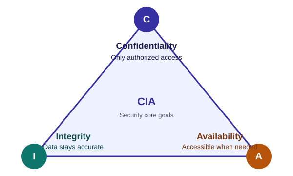

# Cybersecurity — CIA Triad & Basics

## CIA Triad

| Pillar | Goal | Violated by | Protected by |
|--------|------|-------------|--------------|
| Confidentiality | Only authorized people see data | Data breach, eavesdropping | Encryption, access control |
| Integrity | Data not altered improperly | Tampering, malware | Hashing, digital signatures, checksums |
| Availability | Systems usable when needed | DoS/DDoS, hardware failure, ransomware | Redundancy, backups, patching |

## Key Terms

- **Asset** — anything of value (data, system, person).
- **Threat** — potential cause of harm.
- **Vulnerability** — weakness that can be exploited.
- **Exploit** — method/code using a vulnerability.
- **Risk** — likelihood × impact. `Risk = Threat × Vulnerability × Impact`.
- **Countermeasure / Control** — reduces risk.

## AAA

1. **Authentication** — verify identity (password, biometrics, token).
2. **Authorization** — grant permissions.
3. **Accounting** — log actions (audit trail).

Authentication factors: something you **know**, **have**, **are**.

## Core Principles

- **Least privilege** — minimum access needed.
- **Defense in depth** — multiple layers; one failure ≠ breach.
- **Separation of duties** — no single person controls whole critical process.
- **Fail secure** — on error, deny access.
- **Security by design** — build in early, not bolted on.

## Risk Treatment

Mitigate · Transfer (insurance) · Accept · Avoid.

## Gotchas

- Confidentiality vs availability conflict: stricter access can reduce usability.
- Authentication ≠ authorization. Logged in does not mean allowed.
- Security through obscurity alone is not security.

## Quick Recall

> CIA = what to protect. AAA = who gets in. Least privilege + defense in depth = how.
