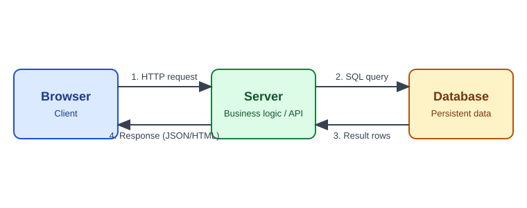

# Back End — HTTP & REST



## Request / Response

- Request: method + URL + headers + optional body.
- Response: status code + headers + body.
- HTTP is **stateless** — each request independent. State via cookies/sessions/tokens.

## Methods

| Method | Purpose | Safe | Idempotent |
|--------|---------|------|------------|
| GET | Read | yes | yes |
| POST | Create | no | no |
| PUT | Replace | no | yes |
| PATCH | Partial update | no | no |
| DELETE | Remove | no | yes |

## Status Codes

| Range | Meaning | Common |
|-------|---------|--------|
| 2xx | Success | 200 OK, 201 Created, 204 No Content |
| 3xx | Redirect | 301 Moved, 304 Not Modified |
| 4xx | Client error | 400 Bad Request, 401 Unauthorized, 403 Forbidden, 404 Not Found, 409 Conflict, 422 Unprocessable |
| 5xx | Server error | 500 Internal Error, 502 Bad Gateway, 503 Unavailable |

401 = not authenticated. 403 = authenticated but not allowed.

## REST Design

Resources as nouns, HTTP verbs as actions.

```
GET    /api/products        list
GET    /api/products/42     read one
POST   /api/products        create
PUT    /api/products/42     replace
DELETE /api/products/42     remove
```

Rules: plural nouns · consistent JSON · correct status codes · version (`/api/v1`) · pagination for lists.

```json
{
  "id": 42,
  "name": "Notebook",
  "price": 59.5
}
```

## Authentication

| Approach | How | Trade-off |
|----------|-----|-----------|
| Session + cookie | Server stores session, client holds ID | Simple; server state |
| JWT | Signed token sent in `Authorization: Bearer` | Stateless; hard to revoke |
| API key | Static key per client | Simple; weak alone |
| OAuth 2.0 | Delegated access via tokens | Complex; standard for third-party |

Cookie flags: `HttpOnly`, `Secure`, `SameSite`.

## Server-Side Checklist

1. Validate input (type, length, range).
2. Authenticate, then authorize each request.
3. Parameterized queries.
4. Hash passwords (bcrypt/Argon2).
5. Handle errors; return generic messages, log details.
6. Rate limiting.
7. Secrets in environment variables.
8. HTTPS only.

## Gotchas

- Never trust client data — hidden fields and JS validation are bypassable.
- Don't return password hashes or internal stack traces.
- Use transactions when multiple writes must succeed together.
- Enable CORS only for trusted origins.
