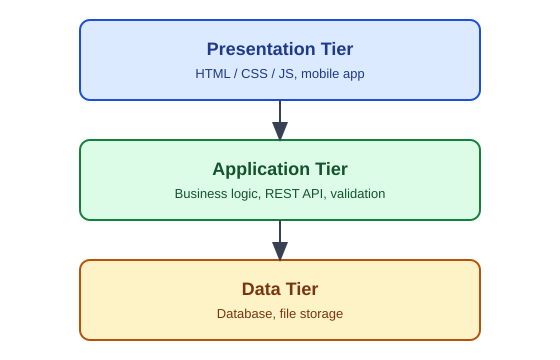

# SIA — Architecture Patterns

## Why Architecture

Structure of components + relationships + rules. Drives scalability, maintainability, security, cost.

## Layered / N-Tier

| Tier | Job |
|------|-----|
| Presentation | UI, user interaction |
| Application / Business | Logic, rules, validation |
| Data | Storage, persistence |

+ Separation of concerns, replaceable layers.
− Extra hops add latency; strict layering can be rigid.

## Client-Server

Clients request, server responds. Thin client (logic on server) vs thick client (logic on client).

## MVC

- **Model** — data and rules.
- **View** — display.
- **Controller** — handles input, coordinates model and view.

## Monolith vs Microservices vs SOA

| Style | + Strength | − Weakness | Use when |
|-------|------------|------------|----------|
| Monolith | Simple deploy, easy debug | Scales as one unit; large codebase coupling | Small team, early product |
| SOA | Reusable enterprise services, shared bus | Heavy middleware, governance cost | Large enterprise integration |
| Microservices | Independent deploy/scale, tech freedom | Distributed complexity, network failures, data consistency | Large teams, differing scale needs |

Avoid microservices if team is small and domain unclear.

## Quality Attributes

Scalability · Availability · Performance · Security · Maintainability · Interoperability.

- Vertical scaling = bigger machine. Horizontal = more machines (needs stateless design + load balancer).

## Common Supporting Components

- **Load balancer** — spreads traffic.
- **Cache** — stores frequent results (e.g. Redis).
- **API gateway** — single entry, auth, rate limiting.
- **Message queue** — async decoupling.

## Single Point of Failure

Any component whose failure stops the system → add redundancy.

## Gotchas

- Distributed systems: network is unreliable; design for timeouts and retries.
- Microservices sharing one database = distributed monolith.
- Document architecture decisions (what, why, alternatives).
